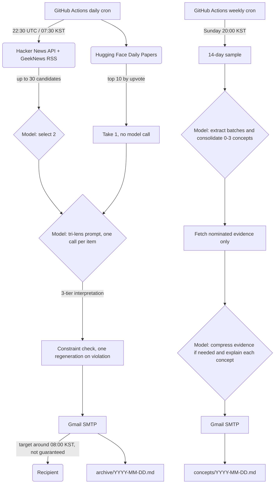

# Tri-Lens News

> Two AI news items and one paper, interpreted at three depths and scheduled for a daily email.

[](LICENSE)


## Motivation

I wanted to keep up with AI news and the papers behind it, and the papers were the part I could not do. Opening an abstract cold, without knowing which of its terms were the point and which were background, meant reading it twice and understanding it neither time. Summaries written for practitioners assume the context I was missing; summaries written for everyone leave out the part I was trying to reach.

So the three lenses are not three audiences. They are one reader climbing. **Everyone** says what happened in plain language, **Developers** says what it does mechanically, **Researchers** says what is still unsettled. Read in order, the first two are the run-up that makes the third readable. There is exactly one subscriber, and this is a tool built for them.

A second problem appears more slowly than a headline: the field starts using a term before it becomes obvious that the term is now part of the working vocabulary. The weekly **Concept Radar** looks for that layer without turning the project into another general-purpose news feed.

## What It Does

The daily job collects candidates from Hacker News, GeekNews, and Hugging Face Daily Papers, filters URLs covered in the last seven days, then attempts a fixed digest of three items. The URL filter is relaxed if it would leave too few candidates; successful delivery is not guaranteed every morning.

- **Two news items**, chosen by the configured model from the news sources for relevance to AI and software
- **One paper**, taken by upvote from the day's curated paper list

Each item is rewritten through three lenses:

- **Everyone** - everyday impact, no jargon
- **Developers** - stacks, implementation consequences
- **Researchers** - open problems and research direction

The paper slot is fixed rather than left to compete with news titles, so research has a place in every completed digest. The prompt requests exactly two sentences per lens; detected formatting violations trigger one regeneration, but remaining violations do not block delivery.

Once a week, Concept Radar samples the previous 14 days of high-signal Hacker News stories, the current GeekNews feed, and the digests that were actually delivered. It nominates at most three reusable AI/ML/software-engineering terms, fetches only the evidence articles needed to check those nominations, and emails a short definition, why the term matters now in the sampled material, where an engineer is likely to meet it, and the supporting links. Terms sent in the previous 90 days are suppressed so the Radar stays a discovery layer rather than a glossary that repeats itself.

## Architecture



The daily path makes four model calls when selection and all interpretations succeed first time: one to select the news and three to interpret. Regeneration, replacement items and transport retries can add calls. The paper is chosen without a model call. Concept Radar extracts candidates in bounded batches, consolidates them across batches, then explains each surviving concept using selected evidence, compressing long evidence when needed. Its call count depends on the sample; it sends nothing when no term survives.

There is no database or application server. The daily and weekly jobs are separate workflows, though they share code, provider quotas and SMTP credentials. Their production archive paths are written after SMTP returns successfully; that does not prove inbox receipt or prevent an archive push from failing. Fetched article bodies are transient in these jobs; local bake-off inputs can retain them in a gitignored directory.

Each delivery workflow has a failure-alert step that emails the sending account rather than the recipient list. A separate weekly keepalive checks on Mondays and attempts an empty commit after at least 45 days without a commit. It is intended to avoid GitHub's inactivity cutoff; its ability to reset that timer has not been verified here. Daily digests are committed under [`archive/`](archive); Concept Radars under [`concepts/`](concepts).

## Tech Decisions

| Component | Choice | Why this over alternatives |
| --- | --- | --- |
| Daily sources | Hacker News · GeekNews · Hugging Face Daily Papers (over raw arXiv) | HN and GeekNews can include research, but do not guarantee a paper slot. The curated paper list provides abstracts and upvotes for selection. The implementation relies on the current shape of the Daily Papers endpoint, so upstream changes can break collection |
| Concept discovery | Weekly 14-day sample from HN Search, GeekNews, and delivered digests | A weekly pass looks for terms that recur across days without adding a fourth daily slot. HN is filtered by age and points before the model sees titles; article text is fetched only for nominated evidence without a stored digest excerpt. The result is a sample, not a claim about field-wide frequency |
| Scheduler | GitHub Actions cron | No application server to keep alive. Standard GitHub-hosted runners are free for public repositories under [GitHub's billing rules](https://docs.github.com/en/billing/concepts/product-billing/github-actions). Scheduling remains best-effort |
| Model | Configurable Gemini or Groq adapter | A shared provider table defines request and response formats. Set `LLM_PROVIDER` and `LLM_MODEL` repository variables to choose a supported model without a commit. Radar adds its own batching and pacing because a single nomination request exceeded a provider limit; limits and model availability still depend on the account and selected model |
| Delivery | Gmail SMTP | Reaches the reader's existing inbox without a separate project account or app |
| Storage | Markdown files in the repo (over a database) | What needs to persist is delivered text, written rarely and read directly. A database would add a service to keep alive in a project whose defining failure was something going quiet unattended. The cost is a repository that grows, slowly, forever |
| Alerting | A step in the same workflow (over a hosted monitor) | Reuses the existing SMTP account without another service. It cannot report a run that never starts, and SMTP failure can also prevent its alert from arriving. The keepalive addresses inactivity but is not an independent missing-run monitor |
| Validation | Rule checks for selected tri-lens constraints; model-based grounding for Concept Radar | Literal format checks are deterministic and add no model call. Radar's explanation stage instead assesses selected evidence and may reject a candidate; this model judgement still needs independent quality evaluation |

Choices made from 2026-08-13 onward are recorded in full where a decision needs a reopen condition, in [docs/decisions.md](docs/decisions.md).

The project aims to fit within free allowances; current billing has not been verified. Model availability, quotas and charges depend on the selected provider and account. Check the provider's current terms, including [Gemini pricing](https://ai.google.dev/gemini-api/docs/pricing), before enabling scheduled calls.

## Prompt Engineering

Early versions produced the usual failure modes: a preamble before the answer ("Sure, I will translate this news for you"), and Markdown syntax that Gmail rendered as literal asterisks.

The prompt was restructured around five techniques, following [Google's prompting guide](https://ai.google.dev/gemini-api/docs/prompting-strategies) and [Anthropic's best practices](https://docs.anthropic.com/en/docs/build-with-claude/prompt-engineering):

- **XML tags** distinguish role, task, constraints and output format within the prompt
- **One-shot anchoring** gives a worked example of the intended tone and an answer that starts without a greeting
- **Negative constraints** request no Markdown, limited repetition of listed filler phrases and exactly two sentences per lens
- **Carry-forward between lenses** tells the model that one reader is going top to bottom, so a lens names the thing the lens above it described in plain words. Before this, an interpretation could explain majority voting over samples and then reintroduce it two lines later as an unglossed term, which is the exact moment a reader loses the thread
- **Terms in English with a bounded gloss** retain the original spelling for lookup. The prompt asks for a gloss only when needed and at most two per lens, avoiding unnecessary explanations of familiar terms such as `weight` and `VRAM`

Concept Radar uses separate extraction, consolidation and explanation prompts. Extraction is instructed to nominate terms supported by sampled titles or delivered interpretations; consolidation selects across batches. Explanation receives selected evidence and may drop a term if it is a product label, a title-only guess or too weakly supported. These are model instructions, not independent factual verification. The prompts also prohibit describing the sample as an industry-wide frequency measurement.

## Results & Limitations

The repository contains daily output records beginning on 2026-08-13 and Concept Radar records beginning on 2026-09-28. Gaps in the archive are not evidence of uninterrupted delivery. The [2026-10-26 local Radar validation](docs/decisions.md#live-validation-on-2026-10-26) recorded 293 sources, 20 successful model requests and 1,039.65 seconds of runtime with SMTP disabled; this is one run, not a reliability or quality benchmark.

Historical sent output is preserved. Known wording and factual corrections are recorded in [Archive Corrections](docs/archive-corrections.md).

- **Automated rule validation**: `evaluate.py` checks lens presence/order, a punctuation-based sentence count, selected Markdown markers and prohibited opening phrases, with one regeneration upon violation. It does not enforce every prompt constraint, and remaining violations can still be sent.
- **Operational safeguards**: Includes keepalive pushes against GitHub Actions inactivity deactivation, sending-account error alerts, and slot-preserving candidate replacement upon model safety filtering.
- **Concept evidence gate**: The weekly job first nominates terms, then fetches only the cited evidence and asks a second pass to discard unsupported or product-specific candidates before delivery.

Known limitations:

- **Faithfulness is unmeasured**: Interpretation quality against source text has not been quantitatively scored. A human labelling rubric and LLM judge agreement plan are defined in [docs/evaluation.md](docs/evaluation.md); collecting reproducible per-item evidence remains pending.
- **Concept Radar is a sample, not a census**: Hacker News is filtered by recent engagement, GeekNews contributes its current RSS window, and delivered digests reflect the project's own editorial selection. A term absent from all three can still matter in the wider field.
- **Delivery timing is best-effort**: GitHub documents that [scheduled jobs can be delayed or dropped](https://docs.github.com/en/actions/reference/workflows-and-actions/events-that-trigger-workflows#schedule). The 07:30 KST trigger is an intention to arrive around 08:00, not a bounded delivery guarantee.
- **Deduplication has fallbacks**: Recent URLs are filtered deterministically when enough candidates remain. Same-event detection uses model judgement; selection fallback may still repeat an event. Radar also relies on model judgement for aliases of previously covered terms.
- **Grounding is incomplete**: News-body fetch failures fall back to titles; fetched news text is capped at 6,000 characters. Radar may use a previous generated digest excerpt as evidence, so earlier errors can carry forward. Neither path establishes factual accuracy.

Detailed design choices and operational incident history are documented in [docs/decisions.md](docs/decisions.md).

## Getting Started

1. Obtain an API key for the selected provider, such as [Gemini](https://aistudio.google.com/), and check model access and quotas for your account.
2. Create a [Gmail App Password](https://myaccount.google.com/apppasswords). This requires 2-Step Verification and an account that [supports app passwords](https://support.google.com/accounts/answer/185833).
3. Fork this repo. Public repositories using standard GitHub-hosted runners have free Actions usage; other runner or repository choices can incur charges.
4. Add four secrets under Settings, Secrets, Actions:
   - `GEMINI_API_KEY`
   - `GMAIL_ADDRESS`
   - `GMAIL_APP_PASSWORD`
   - `RECIPIENTS` (comma-separated)
5. Set `LLM_PROVIDER` and `LLM_MODEL` repository variables under Settings, Variables, Actions to the provider and model you intend to run. Leaving them unset uses the defaults in `scripts/daily_news.py`; confirm those defaults are available to your account before relying on them. For `groq`, add `GROQ_API_KEY` instead of the Gemini key; the unused provider's key may stay absent. The legacy `GEMINI_MODEL` variable is also read when `LLM_MODEL` is empty.
6. Enable Actions in the fork and open the Actions tab. `Tri-Lens Daily News` and `Tri-Lens Concept Radar` support manual dispatch, which makes real API calls and can send real email. The workflows use Python 3.12, install `requests`, `feedparser` and `trafilatura`, and require permission to push archive commits to `main`.

### Offline Checks

For a local checkout with Python 3.12 or later:

```sh
python -m pip install requests feedparser trafilatura
python -m unittest discover -s tests -v
```

Tests use synthetic model/SMTP responses and the tracked archives. They do not validate provider access or inbox receipt. Dependencies currently have no version pins or lockfile, so a later installation may resolve different versions. For model comparison, see `python scripts/bakeoff.py --help`; its `freeze` and `run` commands make real API calls and load model keys from a local, gitignored `.env` based on `.env.example`.

### Email Preview

Daily Brief and Concept Radar share an editorial email layout with a white reading surface, restrained colour accents, and mobile spacing. Preview the latest delivered archives locally with Python 3.12 or later:

```sh
python scripts/preview_email.py
```

Open `preview/index.html` to switch between editions and desktop/mobile widths. The command uses only the Python standard library, reads no credentials, and makes no network or email calls. Generated files are gitignored. To preview a particular issue, pass `--daily archive/YYYY-MM-DD.md` or `--radar concepts/YYYY-MM-DD.md`.

Both senders use the same rendering functions as the preview. Essential styles are inline, with a table-based shell and a narrow-screen media query following [Gmail's CSS support](https://developers.google.com/workspace/gmail/design/css). Browser previews do not verify rendering in Gmail, Outlook, or their dark modes; check a received email before treating client compatibility as verified.

Lens icons use editable SVG sources and inline PNG images in mail. See [Email Design](docs/email-design.md) to change their colours and regenerate the exports.

## Data Handling

This is a personal reading aid, not an independently verified news or research source. Check the linked original before relying on an interpretation. Article excerpts, abstracts and generated digest excerpts are sent to the configured model provider; review that provider's data-use terms before supplying sensitive material. Production archives retain generated output, titles and source URLs publicly. Local bake-off inputs retain fetched text outside Git; upstream articles remain subject to their own rights and terms, not this repository's code licence.

## Roadmap

- [x] **Done:** Add Hugging Face Daily Papers and bounded article-body extraction via Trafilatura.
- [x] **Done:** Check selected format constraints and regenerate once with error feedback.
- [x] **Done:** Apply seven-day URL filtering and model-based same-event suppression, with fallbacks.
- [x] **Done:** Implement the weekly Radar's 14-day sample, bounded model requests and 90-day term history; hosted delivery after the latest fix remains unverified.
- [ ] **Next:** Score faithfulness using preserved source inputs, human labels and held-out judge validation ([evaluation plan](docs/evaluation.md)).
- [ ] **Next:** Add a lightweight email reaction link to collect reader feedback.

## Status

In progress. As checked on 2026-10-28, the [daily workflow completed successfully](https://github.com/liminal-cipher/tri-lens-news/actions/runs/40615785490). The [latest observed hosted Radar run failed on 2026-10-25](https://github.com/liminal-cipher/tri-lens-news/actions/runs/40203484331); the subsequent batching fix passed a local dry run, but its hosted delivery remains unverified. Workflow success is not confirmation that a recipient read or received the message. Last reviewed 2026-10-28.

## Licence

MIT. See [LICENSE](LICENSE).
